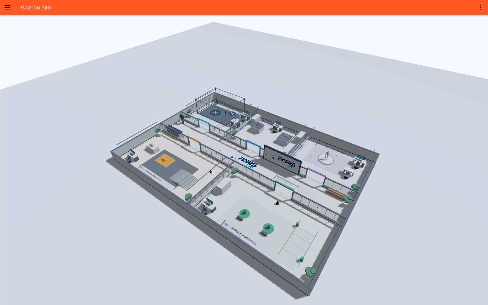
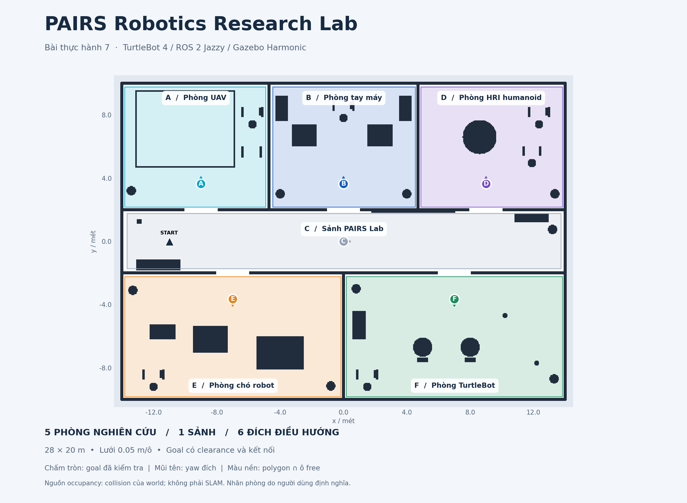

# PAIRS Robotics Research Lab — Bài 7

Môi trường Gazebo Harmonic **28 × 20 m** trên Ubuntu 24.04 / ROS 2 Jazzy, dùng cho phân vùng bản đồ và TurtleBot 4 điều hướng bằng giọng nói tiếng Việt. Thiết kế cập nhật ngày 09/11/2026 theo các hướng nghiên cứu của PAIRS Lab.

## Sản phẩm nộp bài

Source public: [VTongg159/hri-turtlebot4-voice-navigation](https://github.com/VTongg159/hri-turtlebot4-voice-navigation).

- [LaTeX hoàn chỉnh](docs/bao_cao_bai7.tex): phương pháp segmentation, ASR/parser, Nav2, số liệu thực nghiệm và bảng T01–T15; **chưa biên dịch**, các hình chỉ là khung chú thích.
- [Bộ bản đồ gốc, phân vùng và metadata](submission/README.md): PGM/YAML, PNG gốc, PNG A–F, polygon/aliases/goals và validation.
- [Video demo Full HD](submission/PAIRS_Lab_Demo_1080p.mp4), [mốc thời gian](submission/CHAPTERS.md), [14 ảnh báo cáo](submission/figures/).
- [Bằng chứng đã chọn lọc](submission/evidence/), [hash sản phẩm](submission/manifest.json), [kịch bản](docs/KICH_BAN_QUAY_PAIRSLAB.md).

**Phạm vi video:** đoạn từ01:07 có microphone thật→ASR→parser A→Nav2→robot tới phòng UAV. Tour đủ5phòng còn lại dùng văn bản, nhãn2x và có đoạn nối sau mất định vị. Chưa quay riêng đủ cả sáu dạng demo của đề; chi tiết trong kịch bản. Không coi toàn bộ tour là voice test.



## Hình 7 — chụp trực tiếp terminal ngày10/11/2026

[Ảnh terminal sau khi robot đến A](submission/figures/figure7_terminal_live.png) · [Ảnh ASR/parser](submission/figures/figure7_ASR_parser_live.png) · [Video cửa sổ terminal](submission/figure7_terminal_live.mp4) · [Log gốc](submission/evidence/figure7_terminal_live.log) · [Receipt](submission/evidence/figure7_live_acceptance.json).

Đây là lượt microphone mới, bộ ghi hình bật trước thu âm; ảnh/video/log được copy nguyên bytes từ phiên chạy. ASR lần đầu nhận UAB→UNKNOWN_REGION, không gửi goal; lần sau nhận đúng UAV→A→Nav2 SUCCEEDED. Ảnh biên soạn lại trước đó đã được rút khỏi bộ bàn giao. Raw WAV vẫn giữ local.

## Các khu nghiên cứu

| ID | Khu | Model và thiết bị | Goal map x,y (m) |
|---|---|---|---|
| A | UAV | X500, lồng thử bay, bãi đáp H, camera mocap, bàn kiểm tra | -9, 3.65 |
| B | Tay máy | UR5e + UR3e, bàn thao tác, bins, máy trạm | 0, 3.65 |
| C | Sảnh PAIRS Lab | Logo PAIRS + ĐHQGHN gốc, lễ tân, đường đi rộng 4m | 0, 0 |
| D | HRI / humanoid | **Unitree G1**, sân thử tương tác, máy trạm | 9, 3.65 |
| E | Chó robot | **Hai Unitree Go2**, bậc địa hình, bàn bảo trì | -7, -3.65 |
| F | TurtleBot | Hai TurtleBot 4 trưng bày, dock và làn thử navigation | 7, -3.65 |

G1/Go2 dùng mesh từ repository chính thức Unitree, ghép pose bằng URDF forward kinematics; robot trưng bày tĩnh, chưa có controller đi/bay/thao tác. **Một TurtleBot 4 mô phỏng riêng** là robot di chuyển bằng Nav2. Vật cản kiến trúc, bục, bàn và cửa có collision thật. Phần tĩnh được gộp để giảm tải physics; không khởi chạy thêm các sensor/TF/motor plugin của robot trưng bày.

Logo dùng trực tiếp PNG gốc có sẵn của người dùng, giữ nguyên pixel. Model/texture đã được vendor trong package để chạy offline. Nguồn, license và commit xem [PAIRSLAB_ASSETS.md](docs/PAIRSLAB_ASSETS.md).

## Chạy scene mới

Yêu cầu máy đã có Ubuntu24.04, ROS2 Jazzy và môi trường Gazebo/Nav2. Cài dependency package bằng rosdep (cần khởi tạo rosdep nếu máy chưa dùng trước đó):

```bash
sudo apt install python3-venv python3-colcon-common-extensions python3-rosdep alsa-utils
rosdep update
rosdep install --from-paths src --ignore-src -r -y
python3 -m venv --system-site-packages .venv
source .venv/bin/activate
python -m pip install -r requirements-asr.txt
python scripts/download_model.py --model small
```

Tại thư mục gốc workspace này:

```bash
source /opt/ros/jazzy/setup.bash
source .venv/bin/activate
export ROS_DOMAIN_ID=19
python -m colcon build --base-paths src --symlink-install --packages-select tb4_voice_navigation
source install/setup.bash
ros2 launch tb4_voice_navigation voice_navigation.launch.py start_sim:=true enable_asr:=false
```

AMCL tự seed pose xuất phát khi mở mô phỏng mới. Có thể kiểm tra readiness ở terminal thứ hai:

```bash
source /opt/ros/jazzy/setup.bash
source .venv/bin/activate
source install/setup.bash
export ROS_DOMAIN_ID=19
ros2 lifecycle get /amcl
ros2 lifecycle get /bt_navigator
```

Spawn/map pose mới là **(-11,0,0)**. AMCL được cấu hình initial_pose trong pairs_nav2_params.yaml, không teleport. Script initialize_localization.py --fresh-spawn chỉ dành cho khởi tạo lại khi robot thực sự còn ở vị trí spawn; bình thường không cần chạy thêm. Không seed lại pose spawn sau khi robot đã đi xa; dùng RViz2 “2D Pose Estimate” đúng vị trí thực nếu cần. Không chạy hai simulator/pipeline/controller trong cùng domain. Launch dùng ExecuteProcess trực tiếp cho server để dừng sạch khi Ctrl+C, tránh shell orphan và race file SDF tạm.

Nếu chỉ cần Gazebo + RViz + Nav2: `ros2 launch tb4_voice_navigation baseline.launch.py`. `headless:=true` tắt GUI Gazebo; RViz vẫn được mở. Bản campus 14×10m cũ còn nguyên ở `legacy_campus.launch.py`, `maps/campus.*`, `config/regions.yaml`; khi dùng scene cũ phải seed `--x -5.5` và chọn đúng metadata cũ.

## Thay đổi góc camera

```bash
python scripts/pairslab_camera.py overview
python scripts/pairslab_camera.py hri
python scripts/pairslab_camera.py go2
python scripts/pairslab_camera.py uav
python scripts/pairslab_camera.py manipulation
python scripts/pairslab_camera.py turtlebot
python scripts/pairslab_camera.py branding
```

Chỉ thay camera GUI, không thay pose robot. Có thể zoom/orbit tự do trong Gazebo. Ảnh chụp thật từng khu: [G1](docs/pairslab_hri.png), [Go2](docs/pairslab_go2.png), [UAV](docs/pairslab_uav.png), [tay máy](docs/pairslab_manipulation.png), [TurtleBot](docs/pairslab_turtlebot.png), [logo](docs/pairslab_branding.png).

## Bản đồ và semantic regions



`pairs_lab.pgm/yaml`: 580×420 ô, 0.05m/ô, origin [-14.5,-10.5,0]. Đây là map prior sinh từ cùng collision geometry với world, **không phải map SLAM đã quét**. Unknown không được xem là free; planner allow_unknown=false. Goal được kiểm tra free/polygon/clearance tối thiểu0.38m và kết nối tới anchor (-11,0). Runtime vẫn kiểm tra planner/costmap thật.

```bash
ros2 run tb4_voice_navigation map_segmentation src/tb4_voice_navigation/config/pairs_regions.yaml --edit
ros2 run tb4_voice_navigation map_segmentation src/tb4_voice_navigation/config/pairs_regions.yaml --output docs/pairslab_segmentation.png
```

Editor: click trái thêm đỉnh, phải undo, `n` lưu ID/tên/aliases, `g` chỉnh goal, `q` thoát. Metadata/goal/nhãn ở config/pairs_regions.yaml. Không dùng centroid mặc định. `--auto --output docs/pairslab_watershed.npy` xuất gợi ý watershed cần duyệt thủ công.

## Giọng nói và kiểm thử bàn phím

**Đã nghiệm thu giọng nói thật/T15 ngày09/11/2026:** microphone → Whisper → parser → Nav2 → robot thành công cho 3 câu: A, E và A→C→D. Tổng cộng6 lượt ghi,3 lượt đạt; câu2/câu3 có thử lại. Kết quả chi tiết ở [VOICE_TEST_RESULTS.md](docs/VOICE_TEST_RESULTS.md). Khi cần thử, khởi động pipeline với `enable_asr:=true` (mặc định), hoặc chỉ pipeline với `start_sim:=false` nếu simulator đã chạy và chưa có pipeline khác. Đợi MODEL_READY rồi chạy:

```bash
ros2 run tb4_voice_navigation push_to_talk
```

Enter bắt đầu ghi → nói → Enter dừng. Tối đa12 giây/đoạn; Whisper small CPU int8, VAD/no-speech/logprob/RMS/clipping gates. Hệ thống thu bằng arecord/ALSA, không cần PortAudio/API key. Cài ASR khi chưa có .venv/model:

```bash
python3 -m venv --system-site-packages .venv
source .venv/bin/activate
python -m pip install -r requirements-asr.txt
python scripts/download_model.py --model small
python -m colcon build --base-paths src --symlink-install --packages-select tb4_voice_navigation
```

Ví dụ tên phòng mới: “Đi đến phòng UAV”, “Đi đến phòng tay máy”, “Đi đến phòng robot hình người”, “Đi đến phòng chó robot”, “Đi đến phòng TurtleBot”. Chuỗi: “Đi từ phòng UAV qua hành lang đến phòng chó robot”. Phải chờ mission kết thúc trước câu tiếp theo. Lệnh nguồn A→B đi current→A→B, chỉ bỏ qua nguồn khi đang ở gần nguồn. Không dùng tên chung “phòng thí nghiệm” để đoán giữa năm phòng.

Bàn phím kiểm thử parser/controller: `ros2 run tb4_voice_navigation keyboard_command`. Hủy bằng “Dừng lại” qua phiên PTT mới hoặc:

```bash
ros2 service call /voice/cancel std_srvs/srv/Trigger '{}'
```

Ghi âm start/stop/discard: `/voice/record/start`, `/voice/record/stop`, `/voice/record/discard` (std_srvs/Trigger). ASR xử lý sau đoạn ghi nên voice cancel có độ trễ; cancel service dùng được khi ASR đang bận. Xem status: `ros2 topic echo /voice/asr_status --qos-durability transient_local` hoặc `/voice/navigation_status`.

## Build và kiểm chứng

```bash
python -m colcon test --packages-select tb4_voice_navigation --event-handlers console_direct+
colcon test-result --verbose
# Với simulator đã định vị; không chạy các test điều hướng song song:
python scripts/verify_campus_navigation.py --regions src/tb4_voice_navigation/config/pairs_regions.yaml --waypoints A B D C E F --output evidence/pairslab_redesign/navigation.json
python scripts/verify_pairslab_pipeline.py
python scripts/check_scan_alignment.py
```

Kết quả scene mới ở `evidence/pairslab_redesign/`: unit tests, SDF validation, goal validation, native Nav2 đi đủ sáu đích, parser/controller test và scan alignment. Các lượt native navigation không dùng microphone. Thư mục evidence cũ là kết quả campus v1; không dùng kết quả cũ để xác nhận world mới. Nghiệm thu giọng nói thật và các lượt chưa đạt được giữ tại voice_acceptance.json; audio/log gốc trong evidence/voice_demo/ (Git ignore). Đã quay video demo bổ sung 4:26, đủ5phòng và sảnh, có một lệnh microphone cùng lượt; xem [video và kết quả](docs/VIDEO_DEMO_RESULTS.md). Tour văn bản tăng tốc2x, có đoạn nối sau mất định vị được ghi rõ. Xem [báo cáo scene](docs/pairslab_scene_report.pdf) và [trạng thái nghiệm thu](docs/PAIRSLAB_STATUS.md).

## Tái tạo world/model

Runtime đã có đầy đủ mesh/texture. Công cụ authoring tùy chọn:

```bash
python -m pip install -r requirements-scene.txt
python src/tb4_voice_navigation/scripts/generate_pairslab_world.py
```

Generator dùng assets đã vendor, sinh world + occupancy + metadata từ cùng geometry. Nếu thay geometry phải kiểm tra lại goal và chạy lại navigation; evidence cũ không xác nhận sửa đổi mới. `prepare_pairslab_assets.py` tải Unitree theo commit cố định và xuất UR5e/UR3e/TB4 từ ROS packages nguồn; việc này chỉ cần khi tái tạo assets, không cần để chạy scene. Tham số `--px4-models /path/to/PX4/Tools/simulation/gz/models` dùng khi cần import lại X500. Chạy lại generator sẽ ghi lại các file đã sinh.

Dependencies runtime: ROS Jazzy/Nav2/minimal_tb4, ros_gz_bridge/image, Gazebo8, RViz2, rclpy/tf2/messages, OpenCV/NumPy/YAML/Matplotlib/alsa-utils. Đã cài trên máy, không đổi package hệ thống. Authoring UR nguồn dùng ur_description3.5.1; Unitree ROS1 package không được build/cài, chỉ dùng visual URDF meshes nên không kéo ROS1 vào Jazzy.

Source và bộ sản phẩm được công khai tại repository nêu trên. Raw WAV, cache, build/install/log và dump máy cá nhân được loại khỏi Git; giấy phép model và logo được giữ riêng. Tài liệu campus v1 lưu trong docs/archive/ và các PDF cũ để tham chiếu lịch sử.

## Dọn mã và kiểm tra source

Python được định dạng theo Ruff, tách các câu lệnh trên cùng dòng và loại import thừa; cấu hình ở pyproject.toml. Sau dọn mã đã build lại và chạy87test thành công. Không thay đổi grammar, mục tiêu hay chính sách Nav2 để cải thiện số liệu cũ.

```bash
python -m pip install -r requirements-dev.txt
ruff check src/tb4_voice_navigation scripts
ruff format --check src/tb4_voice_navigation/tb4_voice_navigation src/tb4_voice_navigation/launch src/tb4_voice_navigation/test src/tb4_voice_navigation/scripts src/tb4_voice_navigation/setup.py scripts
```

GitHub Actions kiểm tra lint/format và86pure Python tests; test dùng ROS UUID thật được kiểm tra trong87test colcon local. CI không chạy Gazebo/microphone nên không thay thế integration/T15. Các script ghi hình/xuất báo cáo là công cụ tạo bằng chứng local; script phụ thuộc raw voice/video cần có dữ liệu local tương ứng. `scripts/export_submission.py` tạo bộ public sau khi đối chiếu receipt, hash video và goal.
